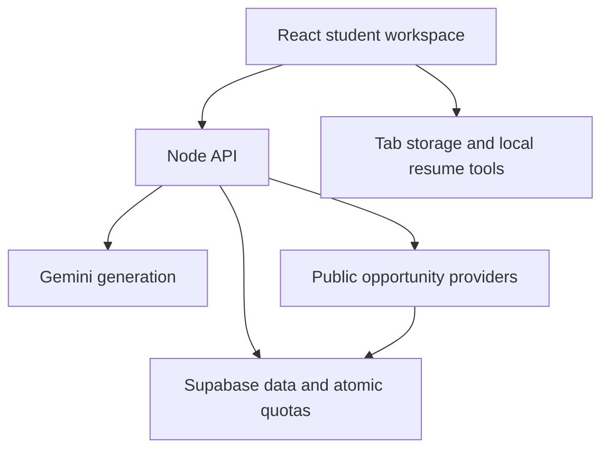

Path4U
Your future. Your path.

Path4U helps students find relevant opportunities, build practical learning plans, and prepare application drafts in one career workspace.

Explore the demo · [**Watch the 95-second walkthrough**](docs/video/path4u-workflow.mp4) · Run locally · Screenshots

[!\[Watch the Path4U walkthrough showing the guest career workspace\]\(docs/video/path4u-workflow.jpg)](docs/video/path4u-workflow.mp4)

The public hackathon release opens in guest mode. Sign In and Create Account are marked Coming Soon. Guest work uses temporary browser-tab storage. Export the material you want to keep.
From a goal to your next step
Students move between opportunity listings, learning resources, and application documents. Path4U brings these tasks into one workspace.
1. Discover an opportunity. Search internships, jobs, hackathons, and workshops, then inspect the original source and available requirements.
2. Build a learning plan. Choose a role or skill, starting level, weekly hours, and duration. Review milestones, projects, and learning resources.
3. Prepare your application. Review a resume, edit application material, and keep notes before using the provider's official submission channel.
Screenshots
Discover opportunities	Build a learning roadmap	Review a sample resume
[!\[Path4U Discover screen with internship cards, search, filters, and original source labels\]\(docs/video/composition/assets/screens/discover.png)](docs/video/composition/assets/screens/discover.png)	[!\[Path4U roadmap with beginner settings, weekly study hours, and cybersecurity milestones\]\(docs/video/composition/assets/screens/roadmap.png)](docs/video/composition/assets/screens/roadmap.png)	[!\[Path4U local Resume Studio showing a fictional sample's rubric score and evidence categories\]\(docs/video/composition/assets/screens/resume.png)](docs/video/composition/assets/screens/resume.png)

Select an image to view it at full size. Discovery and roadmap captures come from the reviewed Preview. Resume Studio shows a fictional sample processed locally. The video includes narration and English captions. [Capture notes and credits](docs/video/README.md)
What you can do
Tool	What it helps you do
Discover	Filter opportunities and inspect original sources, requirements, and known deadlines.
Path4U AI	Ask career and learning questions through the server-side Gemini integration.
Roadmaps and flowcharts	Generate a structured plan, then display a saved roadmap as a flowchart without another generation.
Mind maps	Explore a topic through Gemini-generated branches, then edit and save the map.
Resume Studio	Review supported files on your device with an evidence-based rubric, improve wording, and export editable documents.
Preparation workspace	Keep notes, application drafts, and progress together for your review.

The resume score describes document quality. Hiring outcomes and ATS acceptance depend on the employer and its process. Opportunity availability, eligibility, and submission requirements come from the original organizer. Automatic LinkedIn applications are outside the current workflow.
Architecture

AI requests pass a signed guest session, atomic application quota, and provider-call budget before reaching Gemini. Structured results are validated and returned for review. Saving generated work is an explicit action.
Layer	Implementation
Frontend	React 19, TypeScript, Vite 6, internal history/hash routing
Interface	Monochrome CSS, Lucide icons, Motion for React
API	Node.js handlers in server/, exposed through api/index.mjs
AI	Server-side Gemini REST adapter and validated learning results
Data	Supabase PostgreSQL for durable application data, public caches, and atomic quotas
Guest workspace	Browser-tab storage and local resume processing
Hosting	Vercel frontend and Node serverless API

The account implementation is retained in the source with Supabase Auth, HttpOnly cookies, eligibility checks, and owner-isolated records. Account access is disabled in the public hackathon UI.
Run locally
Use Node.js 22+ and pnpm.
pnpm install --frozen-lockfile
pnpm build
pnpm start
Open 127.0.0.1:4173.

Local development without cloud credentials uses the guided implementation. Live Gemini generation and durable hosted quotas require the configuration below. pnpm dev serves the Vite frontend. API-dependent actions also require the Node server.

For the guest UI, copy .env.example to .env and set DEMO_ONLY_MODE=true. Keep provider and Supabase credentials on the server and out of version control.

<strong>Hosted configuration and database setup</strong>

The live guest implementation requires:
DEMO_ONLY_MODE=true
PATH4U_DATA_BACKEND=supabase
PATH4U_DEMO_BACKEND=supabase
PATH4U_PUBLIC_DEMO=1
SUPABASE_URL=<server-side project URL>
SUPABASE_ANON_KEY=<server-side legacy anon key>
SUPABASE_SERVICE_ROLE_KEY=<server-side service-role key>
GEMINI_API_KEY=<server-side Gemini key>
GEMINI_MODEL=gemini-3.1-flash-lite
OPENPATH_ORIGIN=<approved production HTTPS origin>
PUBLIC_SITE_URL=<approved production HTTPS origin at build time>
Set each variable in the intended Vercel environment. Preview and Production settings can differ. The full repository must be deployed so /api/* runs; a purely static upload cannot generate AI results.

Database schema changes are migrations under supabase/migrations. The existing shared project already has its repair applied. Do not blindly replay historical migrations: some install a project-wide Auth trigger. Audit the destination and apply only reviewed, pending migrations. The current quota repair reuses the existing atomic RPC and needs no new schema migration.

Keep paid features disabled: GEMINI_SEARCH_ENABLED=false, GEMINI_SEARCH_BILLING_APPROVED=false, GEMINI_IMAGE_BILLING_APPROVED=false, GEMINI_PRIVATE_DATA_APPROVED=false. Do not enable billing to run this demo. Live Google Sheets/Gmail require separately configured owner-scoped credentials; Calendar writes and enterprise orchestration remain unconfigured. Course directory links work independently of paid search grounding.

<strong>AI allowance, reset times, and provider limits</strong>

The source quota repair gives each signed browser session 4 shared interactions per UTC day across chat, roadmap generation, flowchart generation and mind maps. Daily allowance renews at 00:00 UTC / 08:00 Asia/Kuala_Lumpur. A saved roadmap can switch between roadmap and flowchart views without consuming an interaction.

Shared application admission remains 80 interactions per UTC day and 4 per fixed UTC minute. Each provider attempt separately passes 400 calls per Pacific day, 10 per fixed UTC minute, and 200,000 estimated input tokens per fixed UTC minute. Google's own project quota remains authoritative and can be lower. Failures after reservation still consume the admitted interaction. Safe public cache hits and successful request-ID replays do not start another provider call.

There is no daily Wi-Fi session or generation cap. A broad anti-abuse throttle permits 120 new guest sessions per network per fixed ten-minute window; existing valid sessions can continue. Cookies are signed, HttpOnly, SameSite=Lax, Secure on HTTPS, valid for 24 hours, and independent of network changes.

See [AI_QUOTA_REVIEW.md](AI_QUOTA_REVIEW.md) for exact rules, affected paths, controlled reset tests, separate Gemini timing and deployment status. The existing public release is not automatically changed by a GitHub commit; the review identifies the tested Preview.

Verification
pnpm typecheck
pnpm test
pnpm build
Controlled tests use isolated storage, provider doubles, and an injected clock. Live provider checks and Production verification are recorded separately.
Evidence	Where to look
Current source quota behavior and Preview checks	[AI quota review](AI_QUOTA_REVIEW.md)
Published demo and its recorded limitations	[Production release record](DEMO_PRODUCTION_RELEASE.md)
Walkthrough captures, subtitles, and attribution	[Video guide](docs/video/README.md)

Preview and Production can run different versions. Check the release records when evaluating the public demo.

<strong>Browser verification commands</strong>

Browser checks need an installed Playwright module and Chrome. Set PATH4U_PLAYWRIGHT_MODULE when Playwright is installed outside this project.
node --test tests/browser-quota-reset.mjs
node tests/browser-demo-only.mjs
node tests/browser-navigation.mjs
node tests/browser-upgrade.mjs
node tests/browser-ai-privacy.mjs
Administrative scripts have explicit opt-in guards. Use the normal verification commands with QA and migration flags unset.

<strong>Security and current integration limits</strong>

Never upload API keys, Supabase credentials, real resumes or private account records to a public repository or demo. Service-only quota tables are protected with RLS and service-role grants; admission is atomic across serverless instances. Storage failure blocks new provider calls. Server checks same-origin writes, validates input and prevents private free-tier AI processing.

Accounts, email delivery, private processing, OAuth, live Google writes and external provider availability must be verified in their intended environment before enabling them. The public hackathon does not advertise these as active. Age entry is self-declared eligibility, not identity verification. Opportunity availability and final submission requirements belong to the original organizer.

Attribution
Path4U's candidate workflow was inspired by AIHawk; this UI and application implementation were written independently. Third-party dependencies keep their own licences. The walkthrough uses Brag, Hyperframes, local Kokoro narration, and credited CC BY 4.0 music. See [video credits](docs/video/README.md).
