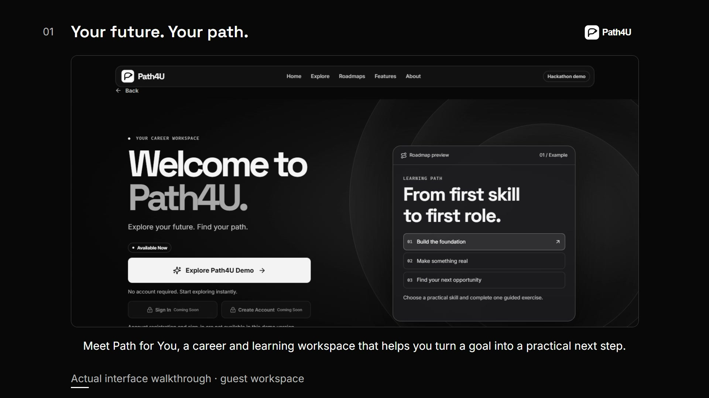
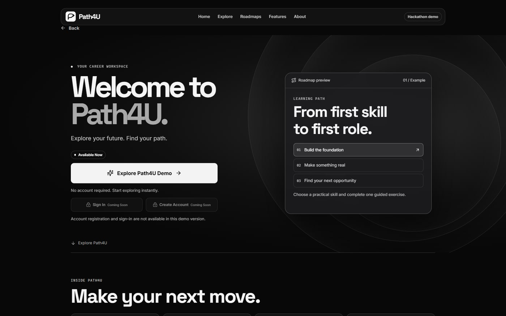
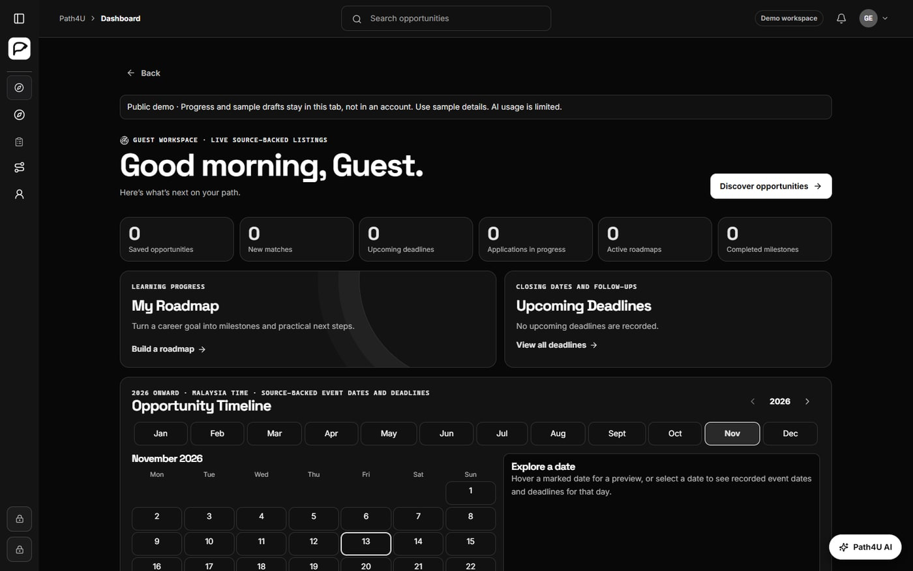
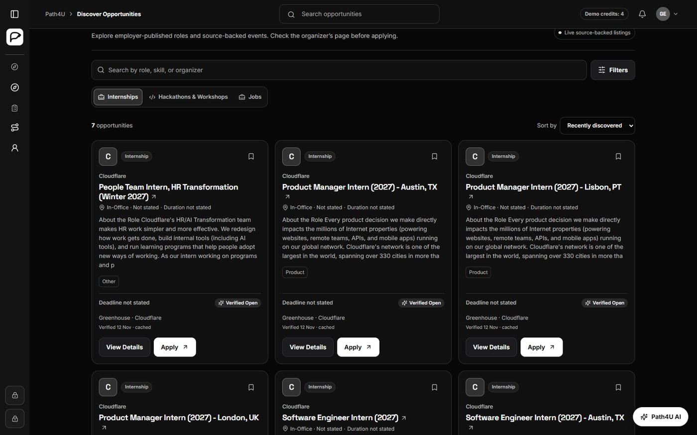
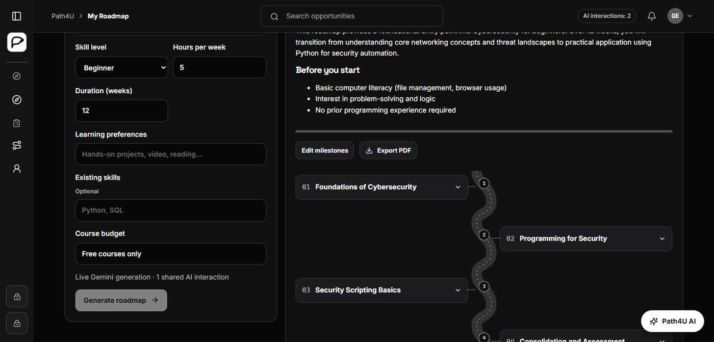
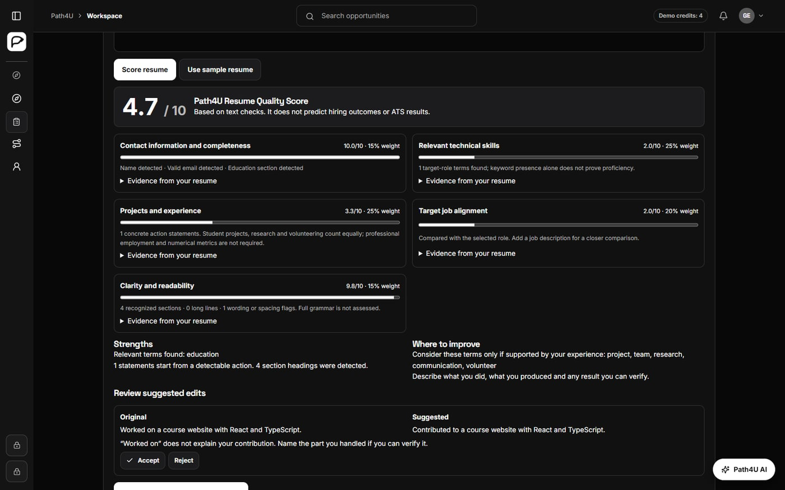
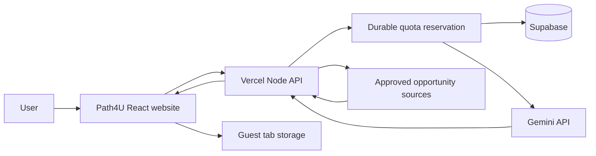

<p align="center"></p>
<h1 align="center">Path4U</h1>
<p align="center"><strong>Your future. Your path.</strong></p>
<p align="center">Path4U helps students find relevant opportunities, build practical learning plans, and prepare application drafts in one career workspace.</p>
<p align="center"><a href="https://path4u.vercel.app">Live demo</a> · <a href="docs/video/path4u-workflow.mp4">Watch the 95-second walkthrough</a> · <a href="#local-installation">Run locally</a> · <a href="#website-screenshots">Screenshots</a> · <a href="docs/pitch/README.md">Pitch deck</a></p>

<p align="center">


</p>

<p align="center"><a href="docs/video/path4u-workflow.mp4"></a></p>

## Hackathon version

**Status: untagged review snapshot.** Package version: `1.0.0`. Published source baseline: [`f39d7be`](https://github.com/SumedSatpathy/Path4U/commit/f39d7be66b29d6b849a1cb02ea21945b17462c31), committed 13 November 2026. A formal submission date and approved release tag have not been supplied.

The public Production deployment predates this source commit. Later AI/quota improvements were tested on a protected Preview. The local documentation/build cleanup and pitch deck are pending review and are not a new deployed release.

## The problem

Students can struggle to choose a career direction, find relevant learning resources, discover suitable opportunities and present their skills clearly. These tasks often require switching between unrelated tools.

## Our solution

Path4U brings opportunity discovery, learning plans and application preparation into one workspace. Users review sources and generated guidance, decide what to save, and submit through an organizer's authorized channel.

1. **Discover an opportunity.** Search internships, jobs, hackathons and workshops, then inspect the original source and available requirements.
2. **Build a learning plan.** Choose a role or skill, starting level, weekly hours and duration. Review milestones, projects and learning resources.
3. **Prepare your application.** Review a resume, edit application material and keep notes before using the provider's official submission channel.

## Key features

| Capability | Current behavior |
| --- | --- |
| Opportunity discovery | Source-backed internships, hackathons/workshops and jobs with original links, filters and explicit unknown fields |
| Learning roadmaps | Career goal, starting level, duration and study hours inform structured plans, milestones and resources |
| Flowchart view | Reuses a saved roadmap without another generation request |
| Path4U AI | Server-side Gemini guidance where the active deployment and quotas permit it; failures show an error |
| Mind maps | Editable branches; genuine Gemini branch generation is a tested Preview improvement, while the earlier public build uses guided suggestions |
| Resume Studio | Resume building, required-field validation, local quality evaluation and editable document exports |
| Preparation work | Guest notes, drafts and progress remain under the user's control |

The public hackathon is guest-first. Sign In and Create Account remain **Coming Soon**. The repository retains account code, but guest mode does not represent users as authenticated or expose private account data.

## Website screenshots

The Production captures below show the real interface on 13 November 2026. Resume content is the built-in fictional sample.

### Welcome


### Guest dashboard


### Source-backed discovery


### Learning roadmap

*Roadmap capture from the tested protected Preview. It does not establish that Production contains the later quota repair.*

### Resume quality review

*The quality rubric evaluates observable text signals. It does not predict hiring success or official ATS acceptance.*

## Technology stack

| Layer | Implementation |
| --- | --- |
| Frontend | React 19, TypeScript, Vite 6 |
| Interface | Existing monochrome CSS system, Lucide icons, Motion for React |
| Routing | Custom internal browser-history/hash router |
| Backend | Node.js handlers exposed through a Vercel Function |
| AI | Server-side Gemini REST calls with structured output validation |
| Durable data | Supabase PostgreSQL and a service-only atomic quota RPC |
| Account implementation | Supabase Auth, eligibility/onboarding checks and owner-scoped records, retained behind guest-only mode |
| Guest workspace | Separate tab-scoped session storage |
| Hosting | Vercel frontend output plus `/api/*` routing |

## System architecture



The server validates input and reserves app/provider capacity before a new live AI request. A separate Save action keeps a generated result in the guest workspace. Account data uses its existing authorization path.

## Local installation

Use Node.js 22+ and pnpm. Keep the committed lockfile.

```sh
pnpm install --frozen-lockfile
```

Copy `.env.example` to `.env` and keep `DEMO_ONLY_MODE=true` for the guest-first UI. Leave cloud credentials empty to use the explicitly guided local demo. Keys belong only in the server environment, never in a `VITE_` variable or public file.

### Run and build

```sh
pnpm typecheck
pnpm test
pnpm build
pnpm start
```

Open [http://127.0.0.1:4173](http://127.0.0.1:4173). This runs the built frontend with the Node API. `pnpm dev` provides the existing Vite frontend development server, and `pnpm preview` previews the static frontend build; those commands alone do not provide the full Node API.

The normal build is `tsc --noEmit && vite build --configLoader runner`. It performs no remote migration, mail test, account administration or provider verification. The preserved operator scripts are separate: `pnpm ops:preview --help`. Each operation requires its original opt-in flag and Preview environment. Database, account/password, mail and repair operations require the appropriate owner authorization; Preview can share Production storage.

Vercel still uses `pnpm build`, output directory `dist`, the existing `api/index.mjs` function and the existing API rewrites. No hosting setting changed for this cleanup.

## Verification

Run `pnpm typecheck`, `pnpm test` and `pnpm build`. Controlled quota tests use isolated storage, provider doubles and a test clock; they do not exhaust or reset a live provider quota.

<details>
<summary>Browser verification commands</summary>

Browser checks require Playwright and Chrome. Set `PATH4U_PLAYWRIGHT_MODULE` when Playwright is installed outside this project.

```sh
node --test tests/browser-quota-reset.mjs
node tests/browser-demo-only.mjs
node tests/browser-navigation.mjs
node tests/browser-upgrade.mjs
node tests/browser-ai-privacy.mjs
```

Keep QA and migration flags unset for routine verification.

</details>

## Environment setup

A live hosted guest backend uses `DEMO_ONLY_MODE=true`, `PATH4U_DATA_BACKEND=supabase`, `PATH4U_DEMO_BACKEND=supabase` and `PATH4U_PUBLIC_DEMO=1`, with server-only `SUPABASE_URL`, `SUPABASE_ANON_KEY`, `SUPABASE_SERVICE_ROLE_KEY` and `GEMINI_API_KEY`. The default text model is `gemini-3.1-flash-lite`.

Set `OPENPATH_ORIGIN` to the approved Production HTTPS origin and `PUBLIC_SITE_URL` to that origin at build time. Preview and Production variables can differ. Deploy the full API project; a static-only upload cannot generate live AI results.

Keep paid search/image flags and private free-tier resume processing disabled. Do not enable billing for this demo. Live Google writes require separately configured, authorized integrations.

Preserve `supabase/migrations/`. The existing shared project already has its reviewed repair applied. Do not blindly replay historical migrations: some install project-wide Auth triggers. Schema changes require a destination audit and approval.

## Demo limitations and known issues

- Public account actions remain Coming Soon. Retained auth code does not mean public sign-in is enabled.
- Guest work stays in this tab's session storage and may disappear when the tab closes. Export important work.
- The repaired Preview shares **4 interactions per guest session per UTC day** across chat, roadmaps, flowcharts and mind maps. The app day resets at **00:00 UTC / 08:00 Malaysia**. Shared app/provider budgets still apply.
- The earlier public Production build retains daily network caps and its one-roadmap sublimit. The Preview repair replaces those daily network gates with a broad short session-creation throttle.
- Google's independent daily project quota resets at Pacific midnight, not at the app's Malaysia morning reset. Storage errors, missing credentials, unavailable models and exhausted limits can still block AI.
- Unknown listing fields remain unknown, and organizers can change availability or deadlines.
- Live Calendar writes, paid web grounding, enterprise orchestration and private free-tier resume AI processing are not active.
- Large document/PDF export chunks produce a Vite size warning. The build succeeds; bundle optimization remains future work.

### AI usage rules in the repaired Preview

| Gate | Rule |
| --- | --- |
| Guest session | 4 accepted interactions per UTC day, shared across chat, roadmaps, flowcharts and mind maps |
| Shared app capacity | 80 accepted interactions per UTC day and 4 per fixed UTC minute |
| New-session throttle | 120 new sessions per network per fixed ten-minute window; existing valid sessions continue |
| Provider safety budgets | 400 attempts per Pacific day, 10 per fixed UTC minute and 200,000 estimated input tokens per fixed UTC minute |
| Retained account policy | 12 interactions and 2 roadmaps per eligible account per UTC day; public account access remains disabled |

The app day resets at 00:00 UTC / 08:00 Malaysia. Open tabs refresh their server-reported balance at the boundary and on focus. Viewing a saved roadmap as a flowchart requires no new generation. Accepted failed requests still consume allowance; matching request-ID replays do not charge twice. The closed public-question cache can reuse answers without another provider call and excludes goals, private attachments and conversation history.

Provider counters track actual attempts, including the single allowed retry after an upstream 503. Input accounting estimates ceil(UTF-8 request bytes / 2) + 512. Google's own project limits remain authoritative. Its daily quota resets at Pacific midnight, which is 16:00 Malaysia in standard time or 15:00 during daylight saving. Storage failures block new provider calls. Cookies are signed, HttpOnly, SameSite=Lax, Secure on HTTPS and limited to 24 hours. These are session safeguards, not identity verification.

## Team SOUL

- **Sumed Satpathy**
- **Shayan Tanveer Khan**
- **Syed Md Takiuddin Ali**

## Future improvements

Planned work includes enabling verified account access after its remaining provider checks, improving bundle size and accessibility coverage, and adding approved Calendar/Google integrations. These are future directions, not current public-demo claims.

## Project materials

- [Pitch deck and speaker notes](docs/pitch/README.md)
- [Narrated workflow, captions and editable composition](docs/video/README.md)

Path4U's candidate workflow took inspiration from AIHawk. The implementation, existing logo and UI are maintained in this repository. Dependencies retain their own licences, and the walkthrough includes credited CC BY music. There is currently no project-wide licence file; public visibility alone does not grant a licence. Do not infer an MIT licence for Path4U.
